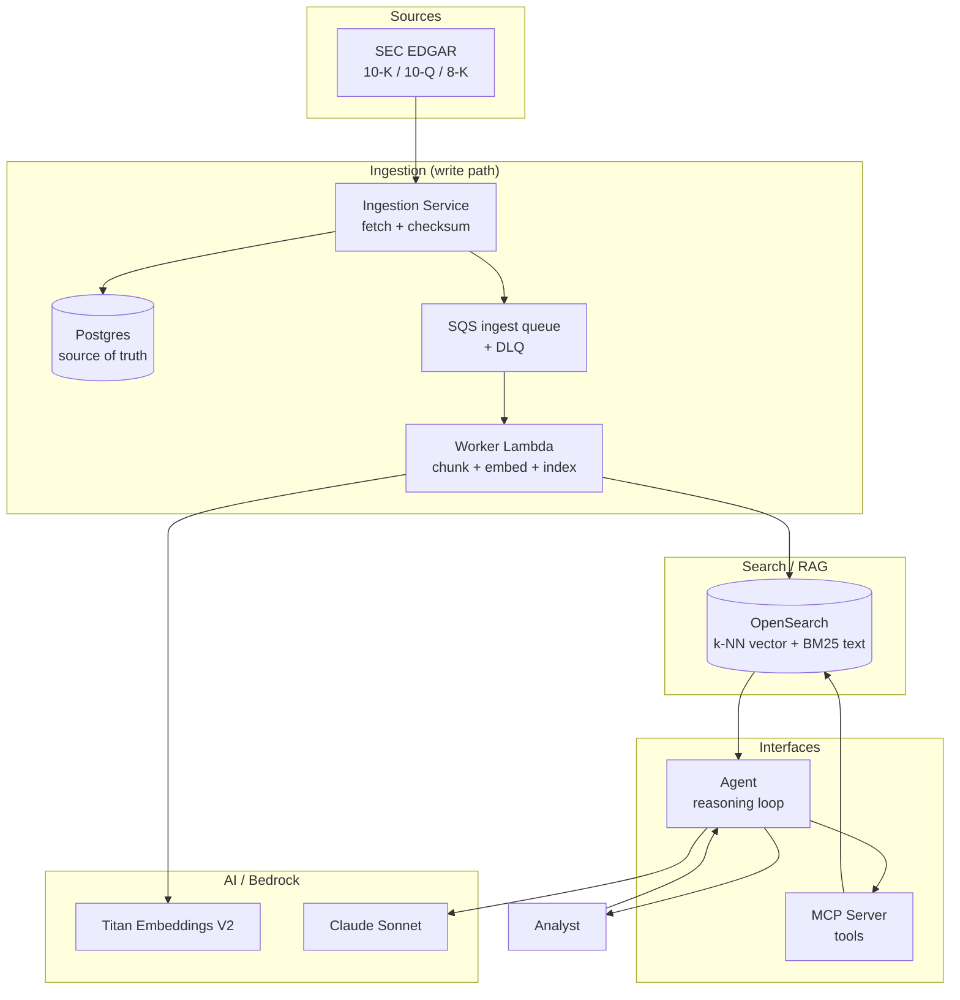
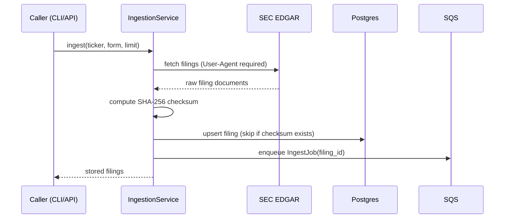
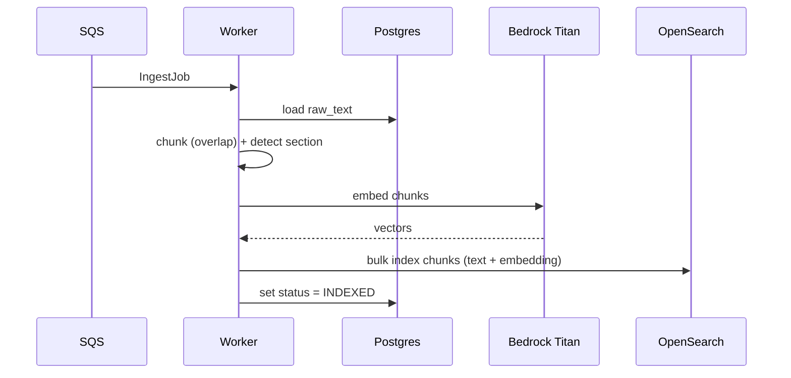
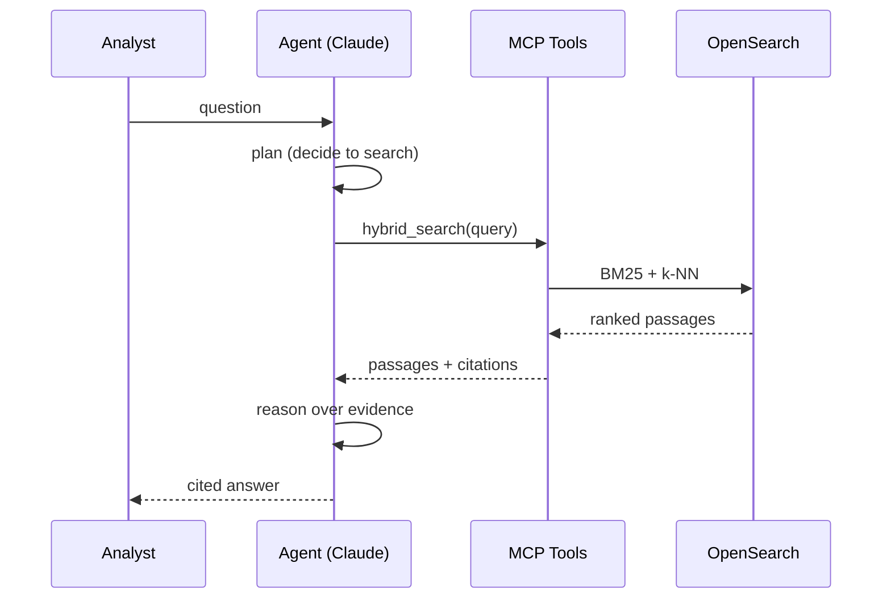

# Architecture

This document describes the high-level (HLD) and low-level (LLD) design of the
Filings Assistant.

## System overview

The system has two data flows — an **ingestion (write) path** and a **query
(read) path** — sharing one search index and one source-of-truth database.



## Ingestion (write path)



Key properties:
- **Idempotent** — a unique constraint on the content checksum means re-ingesting
  the same filing is a no-op (no duplicate indexing).
- **Decoupled** — ingestion returns fast; the slow embed/index work is async.

## Worker (async indexing)



On repeated failure, SQS routes the message to the **dead-letter queue** after
`maxReceiveCount` (5) attempts, so a poison filing can't block the pipeline.

## Query (read path) — Agentic RAG



## Hybrid search + fusion

Two retrieval signals are combined with **Reciprocal Rank Fusion (RRF)**:

- **BM25 keyword** — precise for exact terms/phrases (tickers, defined terms).
- **k-NN vector** (Titan embeddings) — captures meaning/paraphrase.

RRF fuses the two *rankings* (not raw scores, which are on different scales):

```
RRF(d) = Σ  1 / (k + rank_d)      across both result lists (k = 60)
```

This reliably beats either signal alone and needs no score normalization.

## Components

| Component | Module | Responsibility |
|---|---|---|
| Config | `common/config.py` | Env-driven settings, run modes |
| Bedrock client | `common/bedrock.py` | Titan embed + Claude converse (+ mock) |
| Storage | `common/storage.py` | Postgres repo + SQS queue (+ in-memory) |
| Models | `models/filing.py` | Filing, Chunk, SearchHit, IngestJob |
| SEC client | `ingestion/sec_client.py` | EDGAR fetch (+ offline samples) |
| Ingestion | `ingestion/service.py` | fetch → store → enqueue |
| Worker | `worker/processor.py` | chunk → embed → index |
| Chunker | `search/chunker.py` | overlapping windows + section detect |
| Vector store | `search/opensearch_store.py` | index mapping + queries (+ in-memory) |
| Search | `search/service.py` | keyword / semantic / hybrid (RRF) |
| Tools | `mcp_server/tools.py` | shared tool registry + schemas |
| MCP server | `mcp_server/server.py` | expose tools over MCP stdio |
| Agent | `agent/agent.py` | bounded tool-use reasoning loop |

## Local vs AWS parity

Every external dependency has a local implementation selected by config, so the
same application code runs offline (in-memory + mock Bedrock) or on AWS (RDS,
SQS, OpenSearch Service, Bedrock) by changing env vars — no code branches in
business logic.

| Dependency | Local | AWS |
|---|---|---|
| Embeddings / LLM | Mock (hash vectors, templated answers) | Bedrock (Titan, Claude) |
| Vector store | In-memory brute-force | OpenSearch Service |
| Source of truth | In-memory dict | RDS Postgres |
| Queue | In-memory deque | SQS (+ DLQ) |
```
